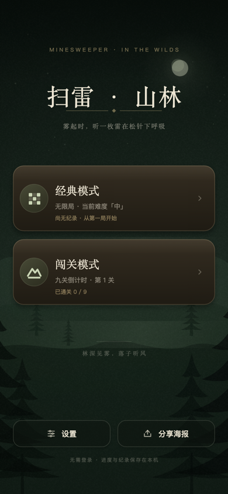
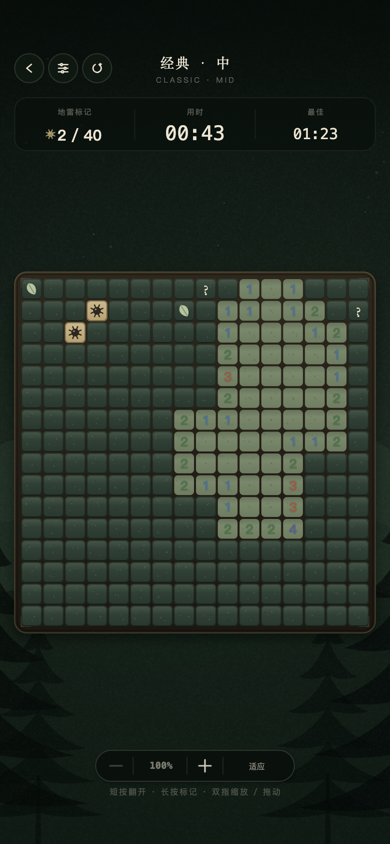
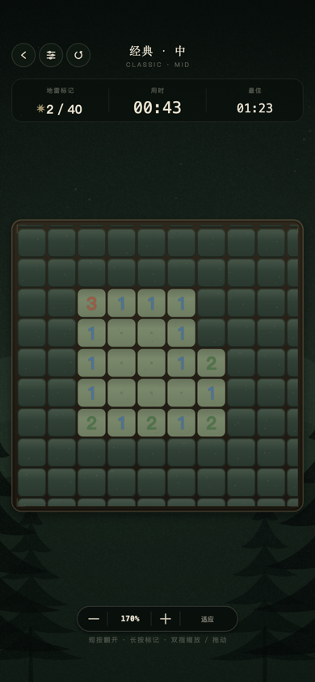
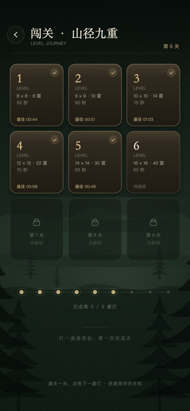
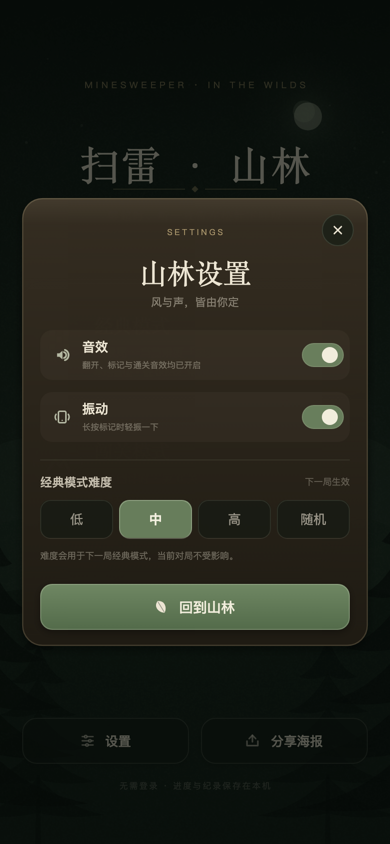
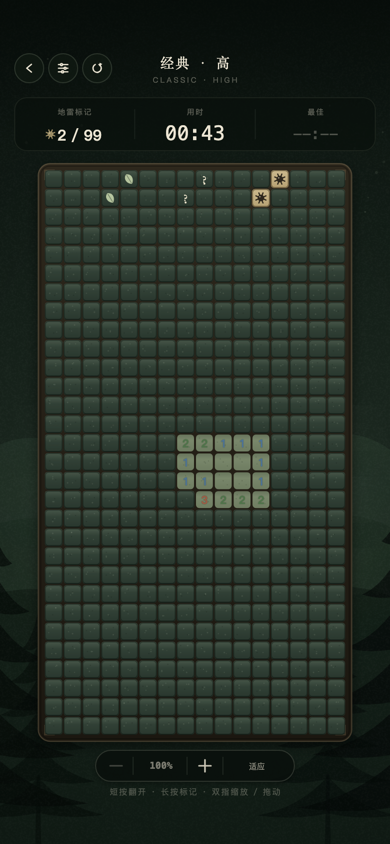
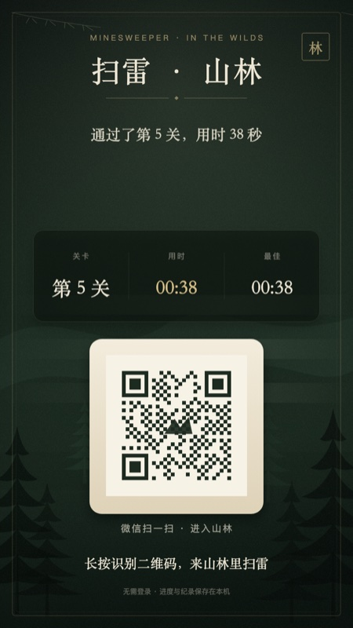
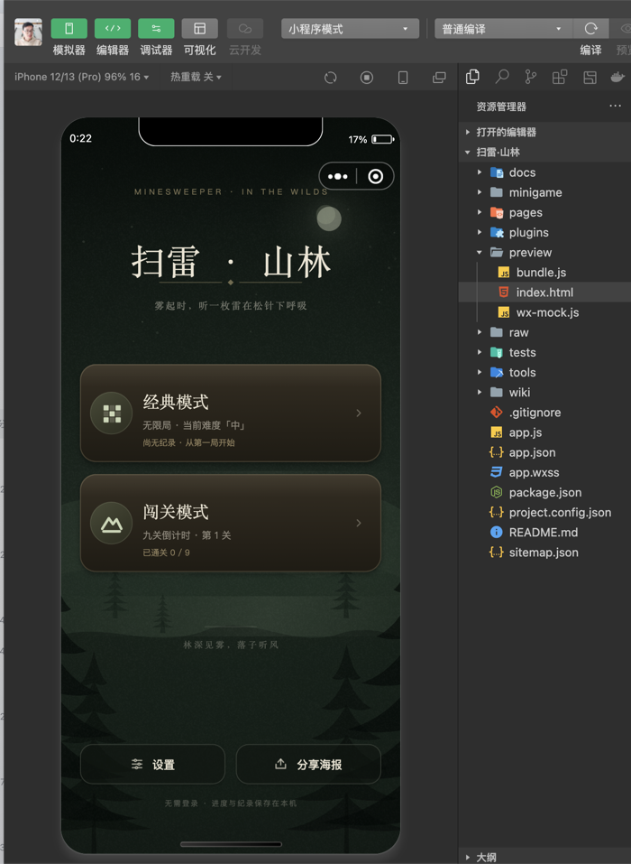

# 扫雷 · 山林


> 微信小游戏 · Canvas 2D · 单机扫雷 · 无需登录
>
> A hand-drawn forest Minesweeper for WeChat — zero login, zero backend, all UI rendered with Canvas 2D.

以“山林”自然质感为视觉基调的扫雷小游戏：经典模式无限局，闯关模式 9 级倒计时递进；全部游戏界面由 Canvas 2D 自绘，不使用 WXML / WXSS（根目录预览壳仅用一个 canvas 宿主页面承载）；进度、设置与纪录保存在本机，业务上不依赖后端（仅小程序码使用云函数，失败自动降级）。

**当前状态**：核心玩法、棋盘缩放/平移、海报与本地存档已完成；24 项单测 + 46 项交互回归通过。真机音频、振动、图片分享与云函数仍需最终复核。

<p align="center">
  
  
  
</p>

**文档**：[产品需求 PRD](docs/PRD.md) · [验收对照](docs/ACCEPTANCE.md) · [开发者工具说明](docs/DEVTOOLS.md)

---

## 目录

- [项目形态](#项目形态)
- [亮点](#亮点)
- [快速开始](#快速开始)
- [玩法与交互](#玩法与交互)
- [技术架构](#技术架构)
- [项目结构](#项目结构)
- [测试与验收](#测试与验收)
- [截图](#截图)
- [已知限制](#已知限制)
- [License](#license)

---

## 项目形态

仓库里同时保留两种运行形态，共用同一套游戏内核：

| 形态 | 目录 | 配置 | 用途 |
| --- | --- | --- | --- |
| **微信小程序预览壳** | 仓库根目录 | `compileType: "miniprogram"`，`touristappid` | 在“小程序模式”的微信开发者工具里直接试玩，无需小游戏 AppID |
| **正式小游戏工程** | [`minigame/`](minigame/) | `compileType: "game"`，需小游戏 AppID | 发布、真机调试、分享、云函数 |

> 预览壳只负责承载 Canvas，所有游戏界面仍然是 Canvas；正式发布请使用 `minigame/`。

---

## 亮点

- **经典模式**：低 9×9/10 雷、中 16×16/40 雷、高 16×30/99 雷；首次默认“中”；难度持久化；支持“随机”并展示本局实际难度。
- **闯关模式**：9 关参数与 PRD 一致；进入即倒计时；踩雷/归零失败；通关解锁下一关；进度与最佳用时本地保存。
- **首点安全**：首次翻开时布雷，排除首点及其 8 邻域；可布雷格不足时只排除首点，保证首点不是雷。
- **短按 / 长按**：短按翻开；长按 300ms 循环标记（安全 → 疑似 → 地雷 → 隐藏）；长按轻振动；按钮与棋盘分区处理。
- **缩放 / 平移**：底部缩放条（`− / 百分比 / + / 适应`）+ 双指捏合；放大后单指拖动查看；拖动/缩放不误触翻开；缩放条独立于棋盘，不遮挡格子。
- **四态标记**：叶片 / 问号 / 雷形 / 隐藏，形状差异优先；顶部只统计“地雷标记”。
- **计时与音效**：经典首点后计时，闯关立即倒计时；最后 10 秒脉冲 + 滴答；切后台、打开设置时暂停；本地 WAV，实例复用。
- **分享海报**：750×1334 离屏绘制，状态文案 + 小程序码；保存相册；图片分享 API 不可用时自动降级保存；云函数失败时输出无二维码海报。
- **进入路径**：链接 / 搜索 / 二维码 / 分享卡片统一落地模式选择页；识别 `scene` 的 `c` / `pN`；朋友圈单页（1155）使用内存态并展示引导。
- **容错**：存储损坏、清缓存、非法启动参数均不崩溃；无登录、无排行榜、无内购。

---

## 快速开始

### 1. 本地浏览器预览（不需要微信开发者工具）

预览层 [`preview/wx-mock.js`](preview/wx-mock.js) 模拟了本项目用到的 `wx` API，直接复用 [`minigame/js/`](minigame/js/) 的同一份游戏代码。

```bash
# 生成预览包
node tools/build-preview.js

# 启动本地静态服务
node tools/serve.js
# 打开 http://127.0.0.1:8787/preview/
```

也可以直接用 Chrome 打开 [`preview/index.html`](preview/index.html)。`file://` 下音频自动播放策略因浏览器而异，推荐用本地服务。

调试参数（组合使用）：

| 参数 | 作用 |
| --- | --- |
| `?dev=1` | 显示调试面板与操作提示 |
| `?debug=classic` / `classicHigh` / `classicZoom` | 经典中难度 / 高难度 / 放大演示 |
| `?debug=levels` / `level:5` / `levelPulse` | 选关 / 第 5 关 / 最后 10 秒脉冲 |
| `?debug=settings` / `classicEnd` / `classicLose` / `levelFail` / `levelSuccess` | 设置或对应结算状态 |
| `?debug=poster` / `posterClassic` | 生成闯关 / 经典海报 |
| `?qr=1` / `?share=0` / `?scene=1155` | 模拟二维码 / 分享降级 / 朋友圈单页 |
| `?qrscene=p5` | 模拟扫码进入，提示“好友通过了第 5 关” |

### 2. 微信开发者工具直接试玩（根目录预览壳）

1. 用微信开发者工具打开**仓库根目录**；
2. 顶部保持“小程序模式”，点击「编译」；
3. 模拟器出现“扫雷 · 山林”模式选择页即可试玩。

无需新建项目、无需小游戏 AppID。根目录 [`project.config.json`](project.config.json) 已配置 `compileType: "miniprogram"` 和 `touristappid`。

### 3. 正式小游戏工程

1. 准备**小游戏类型** AppID，替换 [`minigame/project.config.json`](minigame/project.config.json) 中的 `appid`；
2. 开发者工具「新建项目 → 小游戏」，目录选 `minigame/`，不要勾选小程序模式；
3. 编译。详细排错见 [docs/DEVTOOLS.md](docs/DEVTOOLS.md)。

### 4. 云函数（可选）

```bash
cd minigame/cloudfunctions/getQrCode
npm install
```

在微信开发者工具中开通云开发，将环境 ID 填入 [`minigame/js/config.js`](minigame/js/config.js) 的 `CLOUD.env`，右键云函数目录选择「上传并部署：云端安装依赖」。不部署时海报会自动降级为无二维码版本。

---

## 玩法与交互

| 操作 | 行为 |
| --- | --- |
| **短按** | 按下至抬起 <300ms，且未移出格子 → 翻开；已标记格也会翻开（若是雷则失败并清除标记） |
| **长按** | ≥300ms → 标记循环 `隐藏 → 安全 → 疑似 → 地雷 → 隐藏`，触发时轻振动（开关开启） |
| **双指捏合** | 围绕两指中点缩放棋盘，可同时双指平移 |
| **放大后拖动** | 单指移动超过约 7pt → 平移棋盘；松手不翻开 |
| **底部缩放条** | `−` / `百分比` / `+` / `适应`；点百分比或「适应」回到 100% |

- **取消**：100% 时移出格子取消；放大后移动超过阈值进入拖动，同时取消本次短按/长按。
- **首点安全**：点击后才布雷，排除首点 3×3 邻域；若可布雷格不足则只排除首点。
- **展开**：零邻雷格使用 BFS 队列展开；已标记格不会被自动展开吞掉。
- **计时**：经典模式首次翻开开始；闯关进入即开始；设置面板打开、App 切后台、海报预览时暂停。
- **结算**：失败展示全部地雷；结算面板可关闭查看棋盘，点击棋盘可重新打开；胜利自动为全部地雷补旗。

---

## 技术架构

### 渲染

- 主 Canvas + 场景层（`sceneCanvas`）+ 背景层（`bgCanvas`）。
- 背景（山体、松林、雾气、月光、颗粒、暗角）只在尺寸变化时重建。
- 棋盘仅在格子状态变化时重绘对应格子；HUD 计时区域使用背景局部还原后重绘；动画期间只重绘参与动画的格子。
- 缩放/平移通过固定棋盘视口 + 内容偏移实现，视口外裁剪；滚动时只绘制可见格子。
- `requestAnimationFrame` 驱动，无持续整屏重绘；菜单页为静态画面。
- 全 Canvas 自绘：模式选择、选关、对局、设置、结算、海报预览均为 Canvas 页面。

### 输入

- `touchstart` 记录时间、坐标、格子；`touchend` 判定短按；长按定时器 300ms。
- 放大后单指移动超过约 7pt 进入平移；双指捏合围绕中点缩放，同时支持双指平移。
- 按钮、缩放条、棋盘、浮层使用独立命中区，避免穿透。
- 数据坐标统一为 `cells[row][col]`；缩放/平移只改变视口，不改变游戏状态。

### 核心逻辑

- Fisher–Yates 布雷；首点排除 3×3 邻域。
- BFS 展开零邻雷区域；标记格不会被自动展开覆盖。
- 胜负、踩雷、计时、闯关解锁均由 `game-core.js` + `main.js` 状态机驱动。

### 音效与分享

- 每种音效只创建一个 `InnerAudioContext`，`useWebAudioImplement: true`，本地 WAV。
- `touchstart` 播放近静音短音完成解锁；音效开关持久化；中断结束后恢复。
- 750×1334 离屏 Canvas 绘制海报；兼容小游戏 `Canvas.toTempFilePath` 与小程序 `wx.canvasToTempFilePath`。
- 云函数 `wxacode.getUnlimited` 返回小程序码；超时 6s 或无云环境时绘制占位并继续保存/分享。

### 数据

| Key | 内容 |
| --- | --- |
| `settings` | `{ sound, vibrate }` |
| `classicDifficulty` | `low / mid / high / random` |
| `classicBest` | `{ low, mid, high }` |
| `levelProgress` | `{ unlocked, bestTimes }` |

所有读取均校验类型与取值；清缓存后回到默认设置；朋友圈单页模式（1155）使用内存存储，不读写玩家纪录。

---

## 项目结构

```text
.
├── app.js / app.json / app.wxss   # 根目录小程序预览壳
├── pages/index/                   # Canvas 宿主页（仅此页面用 WXML/WXSS）
├── project.config.json            # 预览壳：compileType=miniprogram
├── sitemap.json
│
├── minigame/                      # ★ 正式小游戏工程（发布用）
│   ├── game.js / game.json
│   ├── project.config.json        # compileType=game
│   ├── js/
│   │   ├── config.js              # 难度、关卡外观、颜色、字体、阈值
│   │   ├── levels.js              # 9 关参数、进度、最佳纪录
│   │   ├── game-core.js           # 布雷、首点安全、BFS、标记、胜负
│   │   ├── renderer.js            # 分层渲染、山林视觉、缩放/平移、脏区
│   │   ├── input.js               # 短按/长按/拖动/双指捏合
│   │   ├── audio.js               # WAV 音效实例复用与解锁
│   │   ├── share.js               # 750×1334 海报、二维码、保存/分享降级
│   │   ├── launch.js              # 启动参数与 scene 解析
│   │   ├── storage.js             # 本地持久化与容错
│   │   └── main.js                # 状态机、计时、结算、海报流程
│   ├── audio/                     # 本地合成 WAV 音效
│   └── cloudfunctions/getQrCode/  # 小程序码云函数（可选）
│
├── docs/                          # PRD、验收、开发者工具说明、截图
├── preview/                       # 浏览器预览（wx API mock + bundle）
├── tests/run.js                   # 核心逻辑 / 存储单测
├── tools/                         # 预览构建、交互回归、截图、音频生成
├── raw/                           # 原始 PRD / README 资料
├── wiki/                          # 项目知识库
└── plugins/kb-cockpit/            # 知识库侧栏插件（非游戏运行文件）
```

根目录预览壳只负责承载 Canvas，`minigame/` 保持纯小游戏工程；预览、测试、文档、`raw/`、`wiki/`、`plugins/` 不会被根目录小程序的 `packOptions.ignore` 打包进小游戏包。

---

## 测试与验收

```bash
# 24 项纯逻辑 / 存储单测（Node，无依赖）
npm test

# 46 项浏览器真实交互回归（需要 Chrome）
npm run test:interaction

# 代码更新后重新生成预览包
npm run preview:build
```

交互回归覆盖：短按翻开、首点后计时、长按标记、100% 移出取消、缩放条放大/适应、放大后拖动平移、拖动不误触、双指捏合、按钮视觉、设置面板暂停倒计时、选关、结算关闭/重开、海报生成/保存/无二维码降级、分享降级、二维码海报、扫码 scene 提示、1155 模式。

完整验收对照：[docs/ACCEPTANCE.md](docs/ACCEPTANCE.md)。

---

## 截图

| 模式选择 | 闯关选关 | 设置面板 |
| --- | --- | --- |
|  |  |  |

| 高难度 100% | 放大 170% | 海报成品 |
| --- | --- | --- |
|  |  |  |

<p align="center">
  <strong>微信开发者工具小程序预览壳</strong><br>
  
</p>

---

## 已知限制

1. **高难度格子 100% 尺寸**：16 列在 375–390pt 宽屏幕上无法同时满足“16 列可见 + 每格 ≥28pt”。390×844 下 16×16 约 20.8pt、16×30 约 17.9pt；375×667 下 16×30 约 13–14pt。v1.1 已支持放大到约 56pt/格并拖动查看，100% 仍保留整盘视野。
2. **真机能力**：图片分享 API、保存相册、iOS 静音开关、振动强度、首次音效解锁需真机复核；失败路径已做降级。
3. **云函数与二维码**：需真实 AppID 与云环境；开发版/体验版/正式版 `envVersion` 需真机确认。
4. **游客模式限制**：根目录预览壳使用 `touristappid`，分享、相册、云函数等能力受限，仅用于开发试玩。
5. **性能**：已在桌面 Chrome 与逻辑层压测，未在低端真机做帧率采样；16×30 首次全量绘制与脏区更新处于可接受范围。

---

## License

本项目采用 [MIT License](LICENSE)，Copyright (c) 2026 HuangDesign。

仓库内含的第三方软件（`plugins/kb-cockpit/vendor/force-graph.min.js`）遵循其自身 MIT 许可，版权归原作者所有；完整声明见 [THIRD_PARTY_NOTICES.md](THIRD_PARTY_NOTICES.md)。

---

> 游戏截图来自本地预览环境或微信开发者工具模拟器；二维码为预览用占位图，真机接入云函数后为真实小程序码。
